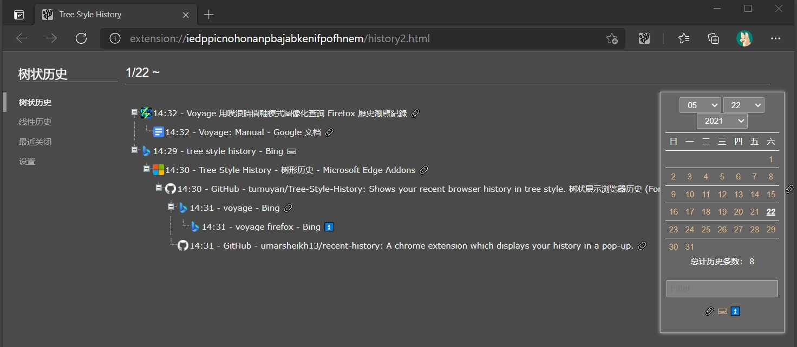

# Tree Style Histyle

 
 
 
  

This extension shows your recent browser history in tree style.  
When you browser pages from internet, you always jump from one page to another by clicking hyper-text links. This extension shows such a jumping relationship through a tree structure, help you find out what you were doing, what website you visited, and whether something has been done.  

Also following features are available.  
1. Use the right-click menu to quickly search the history for current site, or the site linked to.
2. Tree view of recently closed pages. They are group by when they were closed and whether they were closed properly. 
3. Linear view of bookmarks. Usually browser shows bookmarks in tree style, this extension does the opposite, reorders and displays bookmarks by time and site.  
4. Quickly switch tabs in popup page. Sort tabs in reverse order of the time you visited.

This work is based on [Recent History](https://github.com/umarsheikh13/recent-history) and has get the permission to modify and publish the code as a new exttension, many thanks to Umar.  
Currently only Chinese and English UI are available.  

树状展示浏览器历史。
在使用浏览器访问网页时，用户往往会通过点击链接，从一个页面跳转到另一个页面。本扩展通过树状结构展示了这样的跳转关系，从而让用户能够更快地弄清楚自己当时在做什么，访问了什么网站，当时要做的事情是否已经完成。 
除此核心功能外，还有如下特色：  
1. 使用右键菜单，快速搜索当前网站，或者链接指向的网站的访问历史。
2. 树状查看最近关闭的页面。根据关闭页面的时间、是否正常关闭对页面自动分组。批量打开一个分组的全部页面。
3. 线性查看书签。通常浏览器使用树状结构展示书签；本扩展反其道而行，按照时间和网站重新排序并展示书签，方便查看和整理最新收藏的内容。
4. 快速切换最近访问的标签页。在弹窗中按照访问时刻倒序排列标签页。

灵感来自Firefox扩展[voyage](https://docs.google.com/document/d/1oaJjS9zWGQDBzy4wE403P7V2nQukMql_sfvAURl2noI/preview)，后来ff飙版本的时候这个扩展就废了，现在连发布页都被删除。  
我一直没有再见到类似的扩展，所以自己就搓了一个，算是完成多年夙愿。  
基于Umar的扩展[Recent History](https://github.com/umarsheikh13/recent-history)修改，已经获得原作者Umar的许可可以修改并且作为一个新的扩展进行发布，非常感谢他的劳动和许可。 

## Policy  

Tree Style History collects your browser history, analyzes it and stores it on your computer, and shows it when needed.   
It does not upload your browsing history to the Internet or share it with other programs. When you uninstall the extension, all saved data will be automatically erased by the browser.  

One exception worth naming: to draw the little site icons, the extension sends a page's **hostname** (not its URL, title or history) to the favicon service you pick in Options. The default (`duckduckgo`) is a third-party service; switch to the built-in `chrome://favicon/` service in Options if you would rather make no such external requests at all. Icons are cached locally, and the history itself never leaves your machine.  

Tree Style History会收集您的浏览器记录，分析并存储到您的计算机内，并在需要的时候进行展示。  
它不会把浏览记录上传到互联网或者分享给其他程序。当您卸载扩展时，所有保存的数据均会被浏览器自动清除。  

需要说明一个例外：为了显示网站图标，扩展会把页面的**主机名**（不含完整网址、标题或历史记录）发送给您在选项里选定的第三方图标服务，默认服务（`duckduckgo`）即为一例。若不想发起这类外部请求，可在选项中改用浏览器内置的 `chrome://favicon/` 服务；图标会在本地缓存，浏览记录本身始终不会离开本机。  

## Install  
I have uploaded it to Edge Add-ons
https://microsoftedge.microsoft.com/addons/detail/gfmkhnaldbgcpoddmapciblllofekbpn  

I don't have Chrome Web Store developer account, but @oXnMe uploaded it to Chrome Web Store
https://chrome.google.com/webstore/detail/tree-style-history/khcenbpnhbeplojhaolbpldmoppicold  

Or download - unzip - load the folder in developer mode.  
https://github.com/tumuyan/Tree-Style-History/issues/1  

This extension has been migrated to Manifest V3 since 3.2.0.

已经上传到Edge外接程序商店
https://microsoftedge.microsoft.com/addons/detail/gfmkhnaldbgcpoddmapciblllofekbpn  

我没有Chrome商店的开发者帐号,但是有网友代上传了Chrome商店.
https://chrome.google.com/webstore/detail/tree-style-history/khcenbpnhbeplojhaolbpldmoppicold  

或者打开浏览器的开发者模式，[下载压缩包](https://github.com/tumuyan/Tree-Style-History/archive/refs/heads/main.zip)解压并载入  
https://jingyan.baidu.com/article/ca2d939dfa5762ab6d31ce10.html  
https://github.com/tumuyan/Tree-Style-History/issues/1  

## Prompt
这是一个Chrome浏览器扩展。两条约定：  
chrome/scripts/background-utils.js 由 chrome/scripts/modules/shared/ 自动生成（npm run gen），不要手改。  
第三方库（MooTools、jQuery、zTree、fuzzysearch.js）已全部移除，不要再引入。

## Changlog
3.3.2 (未发布)

以「收敛」为主：把 3.3.0 模块化后散落的重复实现合并，补齐自动化校验与端到端交互用例，并修掉一批边界问题。改动较多，按影响面归并如下，逐条评审与校验细节见 CODEBUDDY.md。

**破坏性变更**
- 最低支持的 Chrome 提升到 102（原声明 88）。低版本可安装但一运行就崩，因为依赖 MV3 才有的 `chrome.storage.session` 等 API。

**行为变更**
- 历史缓存改为定时分趟爬取（每趟最多 300 个网址、未完成下趟续、整趟完成后只增量抓新记录），同一时刻只跑一趟，不再启动时一次性跑完整窗口，也避免两趟交错把热力图写偏。
- 日历热力色块改由爬库缓存按访问数逐日汇总并长期保存：`history.html` 打开即已画好，已有数值的日期不再重算；当天始终由页面按行数写入、爬库只回填更早日期；删除历史会同步清掉对应日期的计数与颜色。
- `load-range3`（「缓存保留天数」，默认 120、0 = 永久）此前名存实亡，现在 SW 每天最多一次真清理三个 IndexedDB store 与热力图里过期的记录。
- 「下载参数」只恢复扩展仍有默认值的配置项，不再把云端残留的已删除键写回；被删键同时从本地和 `chrome.storage.sync` 清掉（只认配置项命名空间，不碰热力图/爬库/负缓存等数据）。
- 弹窗每行不再显示「钉住/删除」按钮（它们从未绑定过事件）；此前钉住过的条目仍显示。

**界面与可访问性**
- 两个线性页换 flex/grid 布局（长标题省略、缩放不再挤行、日历两列 grid + sticky 且由 `data-expanded` 控制展开），暗色主题改 `:root` CSS 变量切换，删掉一批 `!important` 覆盖。
- 「加载中 / 无结果」收敛到 `list-status.js`、分组/排序工具栏收敛到 `sort-bar.js`（状态交给 `data-state` + CSS），工具栏图标改内联 SVG + CSS mask（删掉 11 张位图）。
- 书签「编辑书签」由两次 `prompt()` 换成行内面板（标题/网址、Enter 保存 / Esc 取消），网址合法性交给 `chrome.bookmarks.update` 判定，支持 `mailto:` 等合法地址，失败在面板内提示。
- 图标按钮补 `role="button"` 与双 locale `aria-label`/`title`，`outline: none` 换 `:focus-visible` 焦点环；写死的中文占位文案、删除标题、英文 `Liner` 拼写全部走 i18n / 修正。
- 树状历史 / 最近关闭两个核心页补上键盘与读屏支持：树与行分别带 `role="tree"`/`treeitem` 及层级、展开状态，方向键切换行并折叠展开、Enter 打开页面、Home/End 跳首尾、`*` 展开同级；焦点行始终有可见焦点环，筛选框补双 locale 无障碍标签。

**Bug 修复**（同类合并）
- 冷启动与坏数据不再拖垮整页：选项页抢在 worker 写默认值前打开会按钮全死 / 显示 `NaN`；缓存解析失败、一行缺字段、快照顺序异常、`options.html?p=` 未知值会让整个弹窗或后续监听器全丢——现改为兜底或回退。
- 历史 / 书签操作：`history.html?` 带不完整网址、`deleteUrl()` 失败无感知、「最近关闭的标签页」失败静默、删除后日历不刷新、标题写死英文、取消全选刷成第三种底色、标题引号显示成字面实体。
- 日历：跨年整月错位、目标日期错位一天、当天色块被重绘抹掉、颜色分级重复三处。
- 弹窗配额：攒到上限时少显示一条、「最常访问」不足上限时抛异常中断后续区块。
- 定时与缓存：定时器每次 SW 唤醒被重新武装而几乎不触发（连带负缓存 TTL 清扫）、favicon 备用服务把 opaque 响应写进共享缓存污染其他服务、自定义缩放偶发不生效。
- 爬库游标 / 热力图一系列计数偏差（空趟徽标残留、按趟而非按窗口累加、续爬回退导致永久少记、跨生命周期半截状态）收敛成单个带版本号的 `crawl-state` 对象，一趟只读一次、只写一次原子提交。

**清理与文档**
- 删除 MV2 遗留的 `message-adapter.js` 与无发送方的消息分发表、整套不可达的 RTL 分支、零调用的回退 / 死分支及配置项、逐行调试日志、66 张孤儿图片与配套死样式；启动诊断日志收敛到默认关闭的 `DEBUG` 开关。
- 新增静态守卫、单测与真实 Chromium e2e：此前只证明「页面不抛错 / 空列表能画」，现补上树展开折叠、点击跳转、筛选保留祖先链、分组批量打开与四条快捷键等核心交互。
- Policy 补明默认 favicon 服务（duckduckgo）会把页面主机名发送给第三方；浏览历史本身仍只存本地，可在选项改用内置 `chrome://favicon/` 避免外部请求。

3.3.1 (2026/06/19)  
修复设置丢失的bug 
优化自定义缩放的外观

3.3.0 (2026/06/07)  
重构: MooTools 完全移除，全部替换为原生 JavaScript；`func.js` 拆分为 5 个 ES6 模块  
Favicon优化: 增加服务API，缓存请求成功的图片和失败的url，增加次选机制  
新增功能: 自定义弹出窗口和其他页面的缩放比例（25-300%） 
Bug 修复: 若干

3.2.0 (2025/11/10) 修复了一些bug。在AI的协助下已经升级到manifest v3，切换默认分支到mv3-3（因为这是我第3次尝试把扩展升级到mv3）。由于MV3的限制，一些功能的体验会劣化。如：部分页面无法正常显示favicon，在弹窗中点击小书签可能不触发功能。  

3.1.13 (2024/04/29) 调整popup窗口所能显示的项目数量的上限，处理favicon 为空的情况。

3.1.12 (2022/06/23) 增加功能：在弹窗中显示最近浏览的标签页，快速切换标签页; 优化功能（弹窗中的最近关闭的标签页）：数据改为从Chrome API获取，点击改为恢复会话而不是打开网页，关闭窗口显示一笔记录点击时可以直接恢复窗口 

3.1.11 (2022/06/11) 修改选项：自定义点击图标后的动作；调整右键菜单的文本，增加是否显示右键菜单的开关(#15)  

3.1.10 (2022/06/10) 增加功能：在树状历史中点击链接时，如果已经有此网址对应的标签页，则跳转到已经打开的页面，而不新打开页面（另外在测试时发现浏览器要求升级manifest_version，试了试不太能轻松搞定，希望有朋友来帮忙完成更新！）  

3.1.9 (2022/1/27) 完善线性历史、线性书签的外观：为按钮增加提示文字，优化时间显示，去除线性书签的无效checkbox和无效提示内容，显示线性书签的域名分类下包含的书签数量  

3.1.8 (2021/8/9) 增加选项：在“弹窗设置”中增加“显示弹窗”选项，选择是（弹窗）否（打开树状历史）  

3.1.7 (2021/6/24) 修复bug：在“最近关闭”的页面点击链接，会自动打开2个页面

3.1.6 (2021/6/7) 修复bug：Chrome无法显示默认历史管理器的问题（在Edge是正常的）；线性书签无法正常显示小书签（bookmarklet）

3.1.5 (2021/5/29)  
增加功能：线性书签标签页。  
增加选项：指定在popup弹窗中点击“更多”时，打开浏览器默认的页面还是扩展内置页面。  
修复bug：设置-下载参数时弹窗顺序显示有错误；日期没有自动补零。  
已知问题：浏览器限制同一个扩展最多绑定4个快捷键，现在通过特别的方式绑定了5个快捷键，导致扩展默认快捷键无法生效，需要手动设置。

3.1.4 (2021/5/22) - 增加功能：树状历史中显示较少的历史（默认关闭，需要在设置中手动打开），批量打开最近关闭的页面。优化：微调外观，一定程度上实现了窄窗口自适应(但是使用Android kiwi浏览器测试确认手机不能实现主要功能)，统一变更过滤域名的算法  

3.1.3 (2021/5/18) - 增加功能：树状展示最近关闭的页面；修复：令日期和时间选项对树状历史同样生效；优化：微调外观，修改设置中的默认参数。 

3.1.2 (2021/5/11) - 优化搜索浏览记录功能，增加选项同步功能（跟随浏览器账户自动同步），增加快捷键设置（可以通过设置快捷键替换默认历史记录管理器），缓存访问历史的网址数量，优化部分UI的样式和命名，增加清除缓存功能，优化网址过滤功能。

3.1.1 (2021/04/26) - 为树状历史页增加访问类型筛选功能，为树状历史增加loading动画/加大行间距，增加对网址标题特殊符号的处理，历史数量较少时自动载入前日记录，调整默认的设置参数，调整Chrome设置默认历史页面的选项（Edge屏蔽此功能），增加设置页的提示文字，优化历史缓存记录，降低搜索字数限制，增加暗黑模式（根据浏览器设置自动切换），调整popup页面外观，增加右键菜单“搜索此网站的浏览记录”。

3.1.0 (2021/04/18) - Add the basic tree style function.

## License  

Tree Style History, Tree Style History (Toolbar Icon)

Copyright (c) 2021 Tumuyan <tumuyan@gmail.com>
  
This Work is based on Recent History and has get the 
permission to modify and publish the code as a new exttension.
  
----

Recent History, Recent History (Toolbar Icon)

Copyright (c) 2011-2020 Umar Sheikh <hello@umarsheikh.co.uk>

THE EXTENSION IS PROVIDED IN THE HOPE THAT IT WILL BE USEFUL,
BUT WITHOUT ANY WARRANTY. IT IS PROVIDED "AS IS" WITHOUT
WARRANTY OF ANY KIND, EITHER EXPRESSED OR IMPLIED, INCLUDING,
BUT NOT LIMITED TO, THE IMPLIED WARRANTIES OF MERCHANTABILITY
AND FITNESS FOR A PARTICULAR PURPOSE.

IN NO EVENT UNLESS REQUIRED BY APPLICABLE LAW THE AUTHOR WILL
BE LIABLE TO YOU FOR DAMAGES, INCLUDING ANY GENERAL, SPECIAL,
INCIDENTAL OR CONSEQUENTIAL DAMAGES ARISING OUT OF THE USE OR
INABILITY TO USE THE PROGRAM (INCLUDING BUT NOT LIMITED TO LOSS
OF DATA OR DATA BEING RENDERED INACCURATE OR LOSSES SUSTAINED
BY YOU OR THIRD PARTIES OR A FAILURE OF THE PROGRAM TO OPERATE
WITH ANY OTHER PROGRAMS), EVEN IF THE AUTHOR HAS BEEN ADVISED
OF THE POSSIBILITY OF SUCH DAMAGES.

Attribution-Noncommercial-No Derivative Works 3.0 Unported
http://creativecommons.org/licenses/by-nc-nd/3.0/
